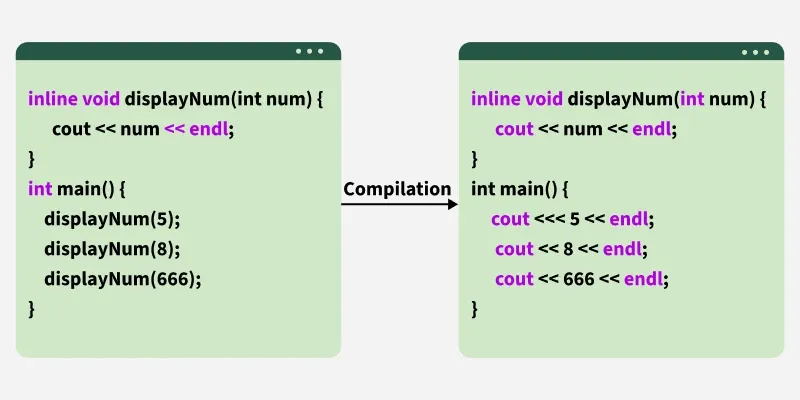

# Inline Functions in C++

A hands-on note about what `inline` really means, why it can make code much faster, and how to measure it correctly.

## Table of contents

1. [What is a function call?](#1-what-is-a-function-call)
2. [What is inlining?](#2-what-is-inlining)
3. [The `inline` keyword: two meanings](#3-the-inline-keyword-two-meanings)
4. [Why inlining makes code faster](#4-why-inlining-makes-code-faster)
5. [The costs of inlining](#5-the-costs-of-inlining)
6. [When to use it and when not to](#6-when-to-use-it-and-when-not-to)
7. [Forcing or forbidding inlining](#7-forcing-or-forbidding-inlining)
8. [The demo in this folder](#8-the-demo-in-this-folder)
9. [Pitfalls when benchmarking inline](#9-pitfalls-when-benchmarking-inline)
10. [Build methods](#10-build-methods)
11. [Results](#11-results)
12. [Vectorization](#12-vectorization)

---

## 1. What is a function call?

When the compiler cannot see inside a function, calling it costs a few steps:

1. Put the arguments in registers (or on the stack).
2. Save the return address and jump to the function (`call`).
3. Run the function body.
4. Put the result in a register and jump back (`ret`).
5. Possibly save and restore registers the function uses.

For a big function this overhead is negligible. For a tiny function such as `x * x`, the overhead can be larger than the real work.

## 2. What is inlining?

**Inlining** means the compiler copies the function body into the place where it is called, so no call happens.

```cpp
int square(int x)
{
    return x * x;
}

int sumOfSquares(int a, int b)
{
    return square(a) + square(b);
}
```

After inlining, the compiler effectively sees:

```cpp
int sumOfSquares(int a, int b)
{
    return (a * a) + (b * b);
}
```

Inlining is an **optimization done by the compiler**. It happens in the compiled machine code. Your source code does not change.


## 3. The `inline` keyword: two meanings

This is the most misunderstood part.

| Meaning | Explanation |
|---|---|
| **Optimization hint (weak)** | `inline` suggests that the compiler inline the function. Modern compilers treat it only as a small hint. They decide using their own cost model and may **ignore** it. |
| **Linkage rule (strong)** | `inline` allows the same function to be **defined in more than one translation unit** (for example, in a header included by many `.cpp` files) without breaking the One Definition Rule (ODR). |

Today the second meaning is the real purpose of the keyword.

**Important facts**:

- A function does **not** need the `inline` keyword to be inlined. At `-O2`/`-O3` (explain later), the compiler can inline any function whose body it can see.
- A function marked `inline` is **not guaranteed** to be inlined.
- These are implicitly `inline`:
  - member functions defined inside the class body
  - `constexpr` functions
  - (C++17) `constexpr` static data members

### The linkage rule (ODR) in practice

**Why a problem exists.** `#include` copies the header text into each `.cpp` file, and every `.cpp` is compiled separately. If a header contains a function body, each `.cpp` that includes it gets its own definition. The One Definition Rule (ODR) allows only one definition of a normal function in the whole program, so the linker fails.

**Broken: no `inline`**

```cpp
// square.h
#pragma once

int square(int x)
{
    return x * x;
}
```

```cpp
// a.cpp
#include "square.h"

int fromA()
{
    return square(2);
}
```

```cpp
// main.cpp
#include "square.h"

int fromA();

int main()
{
    return square(3) + fromA();
}
```

```bash
g++ a.cpp main.cpp -o test
# error: multiple definition of `square(int)'
```

Both `a.cpp` and `main.cpp` define `square()`, so there are two definitions.

**Fixed: add `inline`**

```cpp
// square.h
#pragma once

inline int square(int x)
{
    return x * x;
}
```

`inline` tells the compiler and linker: "this function may be defined in several files, and all definitions are identical, so keep one and merge the rest." The same build now links successfully.

**Notes**

- `#pragma once` (or include guards) does **not** prevent this error. It only stops a header from being included twice in the *same* `.cpp`. The problem here is *different* `.cpp` files.
- All definitions of an `inline` function must be identical.
- Only **definitions** are limited. A declaration like `int square(int x);` can appear any number of times.

**Ways to satisfy the ODR**

| Approach | Result |
|---|---|
| Declaration in `.h`, body in one `.cpp` | One definition (`normalSquare` in this demo) |
| `inline` function in `.h` | Many identical definitions are allowed (`inlineSquare` in this demo) |
| `static` function in `.h` | Each `.cpp` gets its own private copy |
| Member function defined inside a class body, `constexpr` function, or template | Implicitly allowed in many files |

### The key condition: the compiler must see the body

The compiler compiles each `.cpp` file separately. It can inline a function only if the body is visible while compiling the calling file.

| Where the function is defined | Can the compiler inline it? |
|---|---|
| Same `.cpp` file, before or after the call | Yes |
| In a header included by the caller | Yes |
| In another `.cpp` file | **No**, only a declaration is visible |
| In another `.cpp` file, with LTO (`-flto`) | Yes, the linker stage can inline across files |

The demo in this folder uses this rule: `inlineSquare` lives in a header, and `normalSquare` lives in `square.cpp`.

## 4. Why inlining makes code faster

### 4.1 Removes call overhead

No `call`, no `ret`, no argument setup. This is the small, obvious gain.

### 4.2 Unlocks other optimizations (the larger gain)

When the body is visible inside the caller, the compiler can optimize across the old function boundary:

| Optimization | What it does |
|---|---|
| **Auto-vectorization (SIMD)** | Processes several values in one instruction. A real function call inside a loop blocks this. |
| **Loop unrolling** | Repeats the loop body to reduce loop-control cost. |
| **Constant folding / propagation** | If arguments are known at compile time, the result may be computed at compile time. |
| **Dead code elimination** | Removes parts of the function that are never used in this context. |
| **Register allocation** | Keeps values in CPU registers across what used to be a call. |

In this demo, the vectorization effect is usually much larger than the call overhead itself. **Inlining is valuable mostly because it enables other optimizations.**

### 4.3 What this looks like in the demo

```text
Normal  : load -> call normalSquare -> add to sum   (one value at a time)
Inline  : load 4 or 8 values -> multiply all at once -> add   (SIMD)
```

## 5. The costs of inlining

| Cost | Why |
|---|---|
| **Bigger binary (code bloat)** | The body is copied into every call site. |
| **Instruction cache pressure** | Larger code may no longer fit in the CPU's instruction cache, which can make the program slower. |
| **Longer compile time** | More code for the optimizer to process. |
| **Harder debugging** | Inlined functions may not appear in a call stack, and breakpoints may jump around. |
| **Larger recompile scope** | Inline functions live in headers, so changing them recompiles every file that includes them. |

## 6. When to use it and when not to

**Good candidates**

- Very small functions (getters, setters, `x * x`, `min`, `max`, small math helpers).
- Functions called inside hot loops.
- Small functions that must be defined in a header (use `inline` to satisfy the ODR).

**Bad candidates**

- Large functions with many lines or loops.
- Functions called rarely.
- Recursive functions (they cannot be fully inlined).
- Virtual functions called through a base pointer (the target is only known at runtime, unless the compiler can prove the type).
- Functions called through function pointers or `std::function` (the compiler often cannot see the target).

**Practical rule:** write clear code, compile with `-O2` or `-O3`, and let the compiler decide. Use forcing attributes only after you have measured a real reason.

## 7. Forcing or forbidding inlining

These are compiler extensions, not standard C++.

| Compiler | Force inline | Forbid inline |
|---|---|---|
| GCC / Clang | `__attribute__((always_inline)) inline` or `[[gnu::always_inline]]` | `__attribute__((noinline))` or `[[gnu::noinline]]` |
| MSVC | `__forceinline` | `__declspec(noinline)` |

```cpp
__attribute__((noinline))
int normalSquare(int x)
{
    return x * x;
}

__attribute__((always_inline)) inline
int inlineSquare(int x)
{
    return x * x;
}
```

This demo **does not use these attributes**. It uses the file layout (header vs `.cpp`) to get the same effect, which is how real projects behave.

## 8. The demo in this folder

### File layout

```text
inline_function/
├── square.h      // inlineSquare() defined here; normalSquare() only declared
├── square.cpp    // normalSquare() defined here
├── printer.h     // printTimesAsTable(), printSummary()
├── main.cpp      // benchmark
└── README.md
```

### square.h

```cpp
#pragma once
#include <cstdint>

// Defined in the header: the compiler can see the body and inline it
inline std::uint32_t inlineSquare(std::uint32_t x)
{
    return x * x;
}

// Only declared here: the body lives in square.cpp
std::uint32_t normalSquare(std::uint32_t x);
```

### square.cpp

```cpp
#include "square.h"

std::uint32_t normalSquare(std::uint32_t x)
{
    return x * x;
}
```

### What `main.cpp` does

1. Creates 1,048,576 random `uint32_t` values.
2. Defines `measure(f, data, result)`, which runs `f` over the data `REPS` (100) times and returns the elapsed microseconds. This is about 1e8 calls in total.
3. Runs `normalSquare` and `inlineSquare` for `ROUNDS` rounds, **alternating which one runs first**.
4. Prints a per-round table, a summary (average, median, min), and `Results match: yes/no`.

### Expected conclusion

With `-O2`/`-O3`, `inlineSquare` should be clearly faster than `normalSquare`. With `-O0`, there should be little or no difference, because nothing is inlined.

## 9. Pitfalls when benchmarking inline

Each of these happened (or nearly happened) while building this demo.

| Pitfall | Symptom | Fix used here |
|---|---|---|
| **No optimization flag** | Inline and normal look the same | Build with `-O2` or `-O3` and compare levels deliberately |
| **Compiler inlines the "normal" function too** | Both versions have identical speed | Put `normalSquare` in a separate `.cpp`, and do not use `-flto` |
| **Result is not used** | The loop is deleted (dead code elimination) and time is about 0 us | Store the sum and read it later (`Results match`) |
| **Compile-time constant input** | The compiler computes the whole loop at compile time, time is about 0 us | Use random data created at runtime |
| **Same work in every pass** | Compiler computes one pass and multiplies by `REPS` | Use `data[i] + rep` so each pass differs |
| **Signed overflow** | Undefined behavior, unpredictable optimization | Use `unsigned` types (wrap-around is defined) |
| **Run order bias** | The one that runs first is faster or slower (CPU boost, thermals) | Alternate the order each round |
| **Averages hide outliers** | One noisy round distorts the average | Compare the median and the minimum |
| **`-march=native`** | Results depend on your CPU, and the binary may not run elsewhere | Do not use it, so the build is portable |

**If you ever see a time of about 0 us, the compiler removed or precomputed the work. The benchmark is broken, not the compiler being clever for free.**

## 10. Build methods

All builds use the same source files and the same flags except the optimization level. Do **not** add `-march=native` or `-flto`.

### 10.1 Optimization levels

| # | Command | Level | What it means |
|---|---|---|---|
| 1 | `g++ -O0 main.cpp square.cpp -o main_O0` or `g++ main.cpp square.cpp -o main_O0`| `-O0` | No optimization. This is also the default when no `-O` flag is given. Nothing is inlined, and variables live in memory. |
| 2 | `g++ -O1 main.cpp square.cpp -o main_O1` | `-O1` | Basic optimizations. Values are kept in registers, and simple inlining may start. No auto-vectorization. |
| 3 | `g++ -O2 main.cpp square.cpp -o main_O2` | `-O2` | Standard release level. Inlines small functions. Auto-vectorization depends on the GCC version (enabled with a cautious cost model in GCC 12 and newer). |
| 4 | `g++ -O3 main.cpp square.cpp -o main_O3` | `-O3` | Everything in `-O2` plus aggressive loop optimizations and full auto-vectorization. |
| 5 | `g++ -Os main.cpp square.cpp -o main_Os` | `-Os` | Like `-O2` but avoids optimizations that grow the code. |

Notes:

- `-O` is a **capital** letter. `-o` (lowercase) is the output file name.
- `-O0` uses the digit zero.
- `g++ main.cpp -o main` (no `-O`) is the same as `-O0`, so it does not need a separate run.

### 10.2 Optional extra builds

| # | Command | Purpose |
|---|---|---|
| 6 | `g++ -O3 -fno-tree-vectorize main.cpp square.cpp -o main_O3_novec` | Turns off auto-vectorization. Comparing with build 4 shows how much of the speedup comes from SIMD rather than from removing the call. |
| 7 | `g++ -O3 -flto main.cpp square.cpp -o main_O3_lto` | Enables link-time optimization. The compiler can now see `normalSquare` and may inline it, so the gap should shrink. This shows why the file layout matters. |

### 10.3 What each flag does

| Flag | Meaning | Used in the main experiment? |
|---|---|---|
| `-O0` to `-O3`, `-Os` | Optimization level | Yes |
| `-o name` | Output file name | Yes |
| `-march=native` | Use every instruction of the current CPU. Not portable. | No |
| `-flto` | Optimize across `.cpp` files at link time | Only in optional build 7 |
| `-fno-tree-vectorize` | Disable auto-vectorization in GCC | Only in optional build 6 |

### 10.4 Predictions to check later

These are expectations, not facts. Your results may differ by GCC version and CPU.

| Level | Normal (call) | Inline | Expected gap |
|---|---|---|---|
| `-O0` | Slow | Slow | Small or none |
| `-O1` | Faster than `-O0` | Faster than normal | Moderate |
| `-O2` | Similar to `-O1` | Depends on GCC version | Moderate to large |
| `-O3` | Similar to `-O1` | Fastest | Largest |
| `-Os` | Similar to `-O1`/`-O2` | Close to `-O2` | Moderate |

The main questions to answer with real data:

1. How much slower is `-O0` than the other levels?
2. Does the **normal** column stay roughly flat from `-O1` to `-O3`? (It should, because the compiler cannot see into `normalSquare`.)
3. Does the **inline** column improve a lot between `-O1` and `-O3`? (That difference is mostly vectorization.)
4. Did `-O2` vectorize or not on your GCC?

# 11. Results

### 11.1 No optimization flag(default, same as `-O0`)
#### Build command

```bash
g++ main.cpp square.cpp -o main
./main
```

No `-O` flag was given, so GCC uses its default, **`-O0` (no optimization)**. At this level the compiler does not inline anything, even `inlineSquare()`, which is marked `inline`. Both versions therefore make a real function call on every element.

#### Summary

| Metric | Normal (us) | Inline (us) | Speedup (normal / inline) |
|---|---|---|---|
| Average | 591825 | 592280 | 0.999x |
| Median | 595019 | 590320 | 1.008x |
| Min | 559815 | 560000 | 1.000x |

#### Per-round results

<details>
<summary>Click to expand</summary>

| Round | Normal (us) | Inline (us) |
|---|---|---|
| 1 | 559815 | 614282 |
| 2 | 600984 | 604994 |
| 3 | 640560 | 671605 |
| 4 | 578902 | 620845 |
| 5 | 576079 | 574926 |
| 6 | 576086 | 613783 |
| 7 | 581519 | 560000 |
| 8 | 583064 | 574845 |
| 9 | 595154 | 596156 |
| 10 | 595072 | 602331 |
| 11 | 595019 | 594529 |
| 12 | 595712 | 595618 |
| 13 | 596177 | 588212 |
| 14 | 567249 | 562621 |
| 15 | 572571 | 579361 |
| 16 | 598723 | 572918 |
| 17 | 602844 | 590320 |
| 18 | 594235 | 571802 |
| 19 | 659421 | 584078 |
| 20 | 567314 | 572376 |

</details>

#### Observations

- The two versions are essentially the same speed. All three speedups are within about 1% of 1.0x, and the sign changes between average, median and min. That is noise, not a real difference.
- This is expected. At `-O0` the `inline` keyword has no effect on speed, because the compiler does not inline and does not vectorize.
- Both versions are far slower than an optimized build. Each element takes about 6 ns here (roughly 590 ms for 1e8 elements).
- The `-O0` times are also noisier (for example, round 3 and round 19) than a typical optimized run.

### 11.2 `-O1`
#### Build command

```bash
g++ -O1 main.cpp square.cpp -o main
./main
```

`-O1` enables basic optimizations. Values are kept in CPU registers instead of memory, and the compiler can now inline `inlineSquare()` because its body is visible in `square.h`. `normalSquare()` is defined in `square.cpp`, so the compiler still cannot see it and must make a real call. `-O1` does not enable auto-vectorization, so no SIMD is used yet.

#### Summary

| Metric | Normal (us) | Inline (us) | Speedup (normal / inline) |
|---|---|---|---|
| Average | 188263 | 58297 | 3.229x |
| Median | 187811 | 57953 | 3.241x |
| Min | 187451 | 57116 | 3.282x |

#### Per-round results

<details>
<summary>Click to expand</summary>

| Round | Normal (us) | Inline (us) |
|---|---|---|
| 1 | 189549 | 57738 |
| 2 | 187451 | 57116 |
| 3 | 188106 | 60526 |
| 4 | 187869 | 60315 |
| 5 | 188266 | 57904 |
| 6 | 189643 | 57666 |
| 7 | 187811 | 58019 |
| 8 | 187659 | 58163 |
| 9 | 188082 | 57507 |
| 10 | 187595 | 57767 |
| 11 | 187769 | 58090 |
| 12 | 187454 | 58228 |
| 13 | 187792 | 57953 |
| 14 | 187717 | 58518 |
| 15 | 187763 | 57662 |
| 16 | 187743 | 57763 |
| 17 | 187910 | 57711 |
| 18 | 187642 | 57414 |
| 19 | 187852 | 59789 |
| 20 | 193588 | 60097 |

</details>

#### Observations

- This is the first level where `inline` makes a real difference: the inline version is about **3.2x faster** than the normal version. The average, median and min speedups all agree (3.23x to 3.28x), so the result is reliable.
- Compared with `-O0`, the normal version improved about **3.2x** (595019 us to 187811 us by median). The inline version improved about **10x** (590320 us to 57953 us by median).
- The inline version runs at roughly 0.58 ns per element, and the normal version at roughly 1.88 ns. The difference of about 1.3 ns per element is mostly the cost of the real function call.
- No SIMD is involved here, because `-O1` does not auto-vectorize. The gain comes from removing the call and keeping values in registers. Later levels (`-O2`, `-O3`) may add vectorization on top of this.
- The results are much more stable than at `-O0`. Most normal rounds are within about 1 ms of each other. Round 20 (193588 us) is the only visible outlier.

### 11.3 `-O2`
#### Build command

```bash
g++ -O2 main.cpp square.cpp -o main
./main
```

`-O2` is the standard release level. It inlines small functions and, in newer GCC versions (12 and later), also enables auto-vectorization with a cautious cost model. `normalSquare()` is still defined in `square.cpp`, so the compiler cannot see it and must make a real call on every element.

#### Summary

| Metric | Normal (us) | Inline (us) | Speedup (normal / inline) |
|---|---|---|---|
| Average | 161729 | 20849 | 7.757x |
| Median | 161216 | 20797 | 7.752x |
| Min | 160620 | 20562 | 7.812x |

#### Per-round results

<details>
<summary>Click to expand</summary>

| Round | Normal (us) | Inline (us) |
|---|---|---|
| 1 | 166165 | 20823 |
| 2 | 161549 | 22190 |
| 3 | 161939 | 20679 |
| 4 | 161601 | 20725 |
| 5 | 163737 | 20966 |
| 6 | 161893 | 21273 |
| 7 | 161107 | 20797 |
| 8 | 161155 | 20860 |
| 9 | 161068 | 20609 |
| 10 | 160920 | 20847 |
| 11 | 160714 | 20718 |
| 12 | 161447 | 20695 |
| 13 | 160676 | 20800 |
| 14 | 162859 | 20798 |
| 15 | 163592 | 20562 |
| 16 | 161216 | 20837 |
| 17 | 160766 | 20660 |
| 18 | 160891 | 20734 |
| 19 | 160667 | 20694 |
| 20 | 160620 | 20728 |

</details>

#### Observations

- The inline version is about **7.75x faster** than the normal version. The average, median and min speedups all agree (7.76x to 7.81x), so the result is stable.
- Compared with `-O1`, the inline version got about **2.8x faster** (57953 us to 20797 us by median), while the normal version improved only about **1.17x** (187811 us to 161216 us). The extra gain on the inline side is the sign that something beyond plain inlining happened.
- The inline version now takes about 0.2 ns per element. At typical CPU clock speeds that is less than one cycle per element, which is not possible with scalar code. This strongly suggests the loop was **auto-vectorized** (SIMD processing several values per instruction). It also suggests your GCC is version 12 or newer, since older versions do not vectorize at `-O2`.
- The normal version cannot be vectorized, because the compiler cannot see through the call to `normalSquare()`. It still costs about 1.6 ns per element.
- Compared with `-O0`, the inline version is about **28x faster** (590320 us to 20797 us by median) and the normal version is about **3.7x faster** (595019 us to 161216 us).
- Timings are very stable. Only round 1 of the normal version (166165 us) and round 2 of the inline version (22190 us) stand out slightly.
- Takeaway: most of the gap now comes from vectorization, not from removing the call alone. This matches the main point of the experiment: inlining mainly matters because it unlocks other optimizations.

### 11.4 `-O3`
#### Build command

```bash
g++ -O3 main.cpp square.cpp -o main
./main
```

`-O3` includes everything from `-O2` plus more aggressive loop optimizations and full auto-vectorization. No `-march` flag was used, so the compiler targets the baseline x86-64 instruction set (SSE2) and the binary is portable. `normalSquare()` is still defined in `square.cpp`, so the compiler cannot see it and must make a real call on every element.

#### Summary

| Metric | Normal (us) | Inline (us) | Speedup (normal / inline) |
|---|---|---|---|
| Average | 137302 | 22564 | 6.085x |
| Median | 135065 | 21611 | 6.250x |
| Min | 133937 | 21395 | 6.260x |

#### Per-round results

<details>
<summary>Click to expand</summary>

| Round | Normal (us) | Inline (us) |
|---|---|---|
| 1 | 150825 | 21531 |
| 2 | 134566 | 21395 |
| 3 | 134329 | 21505 |
| 4 | 133937 | 21611 |
| 5 | 134394 | 21469 |
| 6 | 133947 | 22414 |
| 7 | 134655 | 21559 |
| 8 | 134346 | 21409 |
| 9 | 134505 | 21518 |
| 10 | 135250 | 21428 |
| 11 | 134568 | 21529 |
| 12 | 138233 | 21426 |
| 13 | 135065 | 22391 |
| 14 | 134589 | 22321 |
| 15 | 136050 | 24610 |
| 16 | 137766 | 23716 |
| 17 | 142521 | 30084 |
| 18 | 136700 | 22174 |
| 19 | 141272 | 22251 |
| 20 | 148522 | 24942 |

</details>

#### Observations

- The inline version is about **6.25x faster** than the normal version by median and min. The average speedup is lower (6.09x) because of noisy rounds near the end of the run.
- **`-O3` is not faster than `-O2` for the inline version.** By median it is 21611 us at `-O3` versus 20797 us at `-O2`, about 4% slower, which is within the noise of this experiment. Both levels probably produce a similar vectorized loop, so there is little left for `-O3` to add for a function this simple.
- The normal version improved a little: 161216 us at `-O2` to 135065 us at `-O3`, about **1.19x faster**. The cause is not visible from timing alone, since the compiler still cannot inline `normalSquare()`. Comparing the assembly of both builds would show what changed.
- Compared with `-O0`, the inline version is about **27x faster** (590320 us to 21611 us by median) and the normal version is about **4.4x faster** (595019 us to 135065 us).
- Per element, the inline version takes about 0.2 ns and the normal version about 1.3 ns. The inline time is below one CPU cycle per element, which is only possible with SIMD, so the loop is vectorized. Since no `-march` flag was used, the vectors are SSE2 (4 values of `uint32_t` per instruction). The array is 4 MB, so the loop may also be limited by how fast data arrives from cache, which would explain why `-O2` and `-O3` end up so close.
- The results are noisier near the end of the run. In rounds 12 to 20, the normal times rise to as much as 148522 us, and the inline times to as much as 30084 us (round 17). This is probably background activity or CPU clock changes on the laptop. It is why the median and min are more trustworthy than the average.

### 11.5 `-Os`
#### Build command

```bash
g++ -Os main.cpp square.cpp -o main
./main
```

`-Os` optimizes for **small binary size**. It enables most `-O2` optimizations but skips the ones that make the code bigger, such as aggressive loop unrolling and loop vectorization. `normalSquare()` is still defined in `square.cpp`, so the compiler cannot see it and must make a real call on every element.

#### Summary

| Metric | Normal (us) | Inline (us) | Speedup (normal / inline) |
|---|---|---|---|
| Average | 165833 | 62265 | 2.663x |
| Median | 162062 | 61882 | 2.619x |
| Min | 160619 | 55666 | 2.885x |

#### Per-round results

<details>
<summary>Click to expand</summary>

| Round | Normal (us) | Inline (us) |
|---|---|---|
| 1 | 163624 | 56060 |
| 2 | 160805 | 56212 |
| 3 | 162159 | 61882 |
| 4 | 161611 | 57694 |
| 5 | 160897 | 56590 |
| 6 | 160893 | 55666 |
| 7 | 161418 | 65386 |
| 8 | 162062 | 63008 |
| 9 | 185228 | 75477 |
| 10 | 187398 | 76463 |
| 11 | 185384 | 65604 |
| 12 | 166975 | 73190 |
| 13 | 167886 | 66632 |
| 14 | 162886 | 64717 |
| 15 | 163097 | 62239 |
| 16 | 160905 | 59753 |
| 17 | 160619 | 58206 |
| 18 | 160769 | 57092 |
| 19 | 160739 | 56511 |
| 20 | 161307 | 56926 |

</details>

#### Observations

- The inline version is about **2.6x faster** than the normal version by median. The min speedup is higher (2.89x) because the min picks the quietest rounds, and the average and median are pulled down by the noisy rounds.
- The inline version performs like `-O1`, not like `-O2` or `-O3`. By median it is 61882 us, versus 57953 us at `-O1` (about 7% slower) and 20797 us at `-O2` (about **3x slower**). The best rounds are almost identical to `-O1` (55666 us versus 57116 us). This points to a scalar loop: the call is gone, but there is no SIMD, which is consistent with `-Os` skipping vectorization.
- The normal version is almost the same as at `-O2`: 162062 us versus 161216 us by median. The cost is dominated by the real function call, which no optimization level can remove while the body lives in another file.
- Compared with `-O0`, the inline version is about **9.5x faster** (590320 us to 61882 us by median) and the normal version is about **3.7x faster** (595019 us to 162062 us).
- Per element, the inline version takes about 0.62 ns and the normal version about 1.62 ns.
- Rounds 7 to 15 are noticeably slower, and rounds 9 to 11 are the worst: the normal version rises to about 185000 us and the inline version to about 76000 us. This looks like background load or CPU clock changes, not an effect of the code. Rounds 16 to 20 return to the quiet baseline. It is another reason to trust the min and median more than the average.
- Takeaway: `-Os` still gets the main benefit of inlining (removing the call), but it gives up the larger gain that comes from vectorization.

### 11.6 Summary of all builds

#### Median comparison

| Build | Normal (us) | Inline (us) | Speedup (normal / inline) |
|---|---|---|---|
| No flag (`-O0`) | 595019 | 590320 | 1.008x |
| `-O1` | 187811 | 57953 | 3.241x |
| `-O2` | 161216 | 20797 | 7.752x |
| `-O3` | 135065 | 21611 | 6.250x |
| `-Os` | 162062 | 61882 | 2.619x |

#### Speedup of inline over normal, by statistic

| Build | Average | Median | Min |
|---|---|---|---|
| No flag (`-O0`) | 0.999x | 1.008x | 1.000x |
| `-O1` | 3.229x | 3.241x | 3.282x |
| `-O2` | 7.757x | 7.752x | 7.812x |
| `-O3` | 6.085x | 6.250x | 6.260x |
| `-Os` | 2.663x | 2.619x | 2.885x |

#### Improvement over `-O0` (by median)

| Build | Normal version | Inline version |
|---|---|---|
| `-O1` | 3.2x faster | 10.2x faster |
| `-O2` | 3.7x faster | 28.4x faster |
| `-O3` | 4.4x faster | 27.3x faster |
| `-Os` | 3.7x faster | 9.5x faster |

#### Ranking (fastest first, by median)

| Rank | Normal version | Inline version |
|---|---|---|
| 1 | `-O3` (135065 us) | `-O2` (20797 us) |
| 2 | `-O2` (161216 us) | `-O3` (21611 us) |
| 3 | `-Os` (162062 us) | `-O1` (57953 us) |
| 4 | `-O1` (187811 us) | `-Os` (61882 us) |
| 5 | `-O0` (595019 us) | `-O0` (590320 us) |

#### What the results show

1. **Without optimization, `inline` does nothing.** At `-O0` both versions run at the same speed (1.008x, which is noise). The `inline` keyword is not what makes code fast. The optimizer is.
2. **Removing the call gives a solid gain.** At `-O1` the inline version is about 3.2x faster than the normal version. There is no SIMD at this level, so this gain comes from removing the function call and keeping values in registers.
3. **Vectorization gives the largest gain.** At `-O2` and `-O3` the inline version reaches about 7.8x and 6.3x over the normal version. It also takes less than one CPU cycle per element, which is only possible with SIMD. This is possible only because the compiler can see the function body and can vectorize the loop. A real call blocks it.
4. **The normal version barely improves.** It goes from 595019 us (`-O0`) to about 135000 to 187000 us at the optimized levels, about 3x to 4x. The compiler cannot see inside `normalSquare()`, so every element still pays for a real call.
5. **`-Os` behaves like `-O1` for the inline version.** `-Os` avoids size-increasing optimizations such as vectorization, so it removes the call but gets no SIMD (61882 us versus 57953 us at `-O1`).
6. **`-O2` and `-O3` are equal here.** The inline medians differ by about 4% (20797 us versus 21611 us), which is within the noise of this experiment. For a function this simple, `-O3` has nothing extra to add.

#### Main takeaways

- **Visibility of the function body decides everything.** `inlineSquare()` was fast because its body is in a header and the compiler can see it. `normalSquare()` was slow because its body is in a separate `.cpp` file. The `inline` keyword itself is mostly a linkage (ODR) tool, not a speed switch.
- **Inlining mainly matters because it unlocks other optimizations** (vectorization, unrolling, register allocation), not only because it removes the call.
- **Always compare optimized builds.** An `-O0` benchmark of inline functions is meaningless.
- **The best case is not typical.** This test is a trivial function in a tight loop that is easy to vectorize. For larger or rarely called functions the difference is usually small.

#### Limits of this experiment

- One machine, one compiler, and one run per build. The compiler version was not recorded in this README.
- No `-march` flag was used, so the compiler targeted the baseline x86-64 instruction set (SSE2). A build with `-march=native` would probably make the inline version faster, but it would not be portable.
- Some rounds are noisy, especially at `-O0`, `-O3` (rounds 12 to 20) and `-Os` (rounds 7 to 15). This is why the median and min are more reliable than the average.
- The optional builds (`-O3 -fno-tree-vectorize` and `-O3 -flto`) were not run. They would separate the vectorization effect from the call-overhead effect, and show how cross-file inlining closes the gap.

## 12. Vectorization

### What is it?

A normal (**scalar**) instruction works on one value at a time. A **vector** instruction works on several values at once. This is called **SIMD** (Single Instruction, Multiple Data).

```text
Scalar:  a[0]*a[0]   then   a[1]*a[1]   then   a[2]*a[2]   then   a[3]*a[3]
         (4 instructions)

SIMD:    [a[0] a[1] a[2] a[3]] * [a[0] a[1] a[2] a[3]]
         (1 instruction)
```

The CPU has special wide registers for this. A 128-bit register holds four `uint32_t` values, and a 256-bit register holds eight.

| Instruction set | Register width | `uint32_t` values per instruction | Where |
|---|---|---|---|
| SSE2 | 128 bit | 4 | Every x86-64 CPU (the default baseline) |
| AVX2 | 256 bit | 8 | Most x86 CPUs since about 2015 (needs `-mavx2` or `-march=...`) |
| AVX-512 | 512 bit | 16 | Some newer x86 CPUs |
| NEON | 128 bit | 4 | ARM CPUs (Apple M-series, Raspberry Pi) |

### Auto-vectorization

You do not write SIMD code yourself. At `-O2` (GCC 12 and newer) or `-O3`, the compiler analyzes loops and rewrites them to use vector instructions when it is safe. This is called **auto-vectorization**.

Your loop:

```cpp
for (size_t i = 0; i < data.size(); ++i)
{
    sum += f(data[i] + rep);
}
```

What the compiler effectively does (simplified, with 4 values per step):

```cpp
// sum4 holds 4 partial sums at once
for (size_t i = 0; i + 4 <= n; i += 4)
{
    sum4 += square4(load4(&data[i]) + rep);   // 4 elements per iteration
}
sum = sum4[0] + sum4[1] + sum4[2] + sum4[3];  // combine the 4 partial sums
// then handle the remaining 0-3 elements one by one
```

The compiler may also unroll the loop so each iteration handles even more elements.

### Why a real function call blocks it

A vector instruction needs to run the same operation on several elements together. If the loop body contains a call to a function the compiler cannot see, it does not know what that function does (side effects, memory access, how long it takes), so it must call it once per element, in order.

| Loop body | Compiler's view | Result |
|---|---|---|
| `sum += inlineSquare(x)` | `sum += x * x`, a plain multiply and add | Can be vectorized |
| `sum += normalSquare(x)` | An opaque call to `square.cpp` | Cannot be vectorized |

This is the main reason the inline version is so much faster in the results: removing the call is the first gain, and vectorization is the second and larger one.

### Conditions for a loop to be vectorized

| Condition | Why |
|---|---|
| No calls the compiler cannot see through | It must know what each iteration does |
| No dependency between iterations (except simple reductions such as `sum +=`) | Iterations must be able to run together |
| The trip count is known at runtime before the loop starts | The compiler can split it into groups |
| Simple memory access (for example `data[i]`) | Values can be loaded together |
| Few unpredictable branches inside the loop | Branches stop all elements from following the same path |

A `sum +=` over integers is a **reduction**. It is allowed because integer addition gives the same result in any order. For `float` and `double`, the compiler will not reorder the additions by default (the result could change slightly), unless you use `-ffast-math`.

### Effect of the instruction set in this demo

The demo was built **without** `-march`, so the compiler used the portable baseline, SSE2 (4 values per instruction). SSE2 has no direct 32-bit vector multiply (that arrived in SSE4.1), so the compiler builds one from several smaller instructions (`pmuludq` and shuffles). Using `-march=native` (AVX2, 8 values, a direct multiply) would probably make the inline version faster, but the binary would no longer run on older CPUs.

### How to check that a loop was vectorized

1. **Ask the compiler:**

   ```bash
   g++ -O3 -fopt-info-vec-optimized -c main.cpp -o /dev/null
   ```

   GCC prints a line such as `loop vectorized using 16 byte vectors` for each vectorized loop. Use `-fopt-info-vec-missed` to see why a loop was not vectorized.

2. **Look at the assembly:**

   ```bash
   g++ -O3 -S main.cpp -o main.s
   ```

   - Vectorized code contains vector instructions, such as `pmuludq`, `pmulld`, `paddd`, and registers named `xmm` (128 bit) or `ymm` (256 bit).
   - The normal loop contains `call normalSquare` on every iteration.
   - A scalar loop contains `imul` and `add` on plain registers like `eax`.

3. **Use the timing as a hint.** If a loop runs faster than one CPU cycle per element, it can only be vectorized. In this demo, the inline version took about 0.2 ns per element at `-O2` and `-O3`.

### Where this showed up in the results

| Build | Inline version | What happened |
|---|---|---|
| `-O0` | About 590 ms | No inlining, no vectorization |
| `-O1` | About 58 ms | Call removed, but scalar code (no vectorization) |
| `-Os` | About 62 ms | Call removed, but vectorization skipped to keep the code small |
| `-O2` | About 21 ms | Call removed and loop vectorized |
| `-O3` | About 22 ms | Call removed and loop vectorized |

The step from `-O1` to `-O2` (about 2.8x for the inline version) is the effect of vectorization alone.